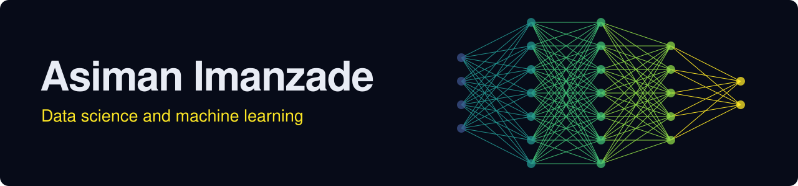

  

  
  
  
  

I study Computer Science at ADA University in Baku. I started in data analytics with Excel, Power BI and SQL, then moved into machine learning through formal training, an internship and projects on real-world data. I also teach and mentor students in Python and machine learning. Next, I am moving toward deep learning, NLP and large language models.

## Projects

| Project | What it does | Result |
|---|---|---|
| [Asiman Data School](https://asiman-data-school.pages.dev) | Learning platform for a 30-week Data Science and AI course, with Python running in the browser | 5 modules, from Python to LLMs and RAG |
| [Mexico City GP Winner Prediction](https://github.com/AsimanImanzade/Mexico-GP-Prediction) ([live dashboard](https://asiman-mexico-gp.pages.dev)) | Predicts the 2026 Formula 1 Mexico City GP winner before and after qualifying, from every race since 2014, with the model running in the browser | Favourite won 72% of 2026 races after qualifying, winner in the top 3 in 94% |
| [Car Price Prediction](https://github.com/AsimanImanzade/Car-Price-Prediction) | Predicts used-car prices in Azerbaijan from 223,758 cleaned turbo.az listings | R² 0.955, MAE 2,368 AZN |
| [Property Deed Classification](https://github.com/AsimanImanzade/House-Price-Prediction) | Predicts whether a property listing has an official deed, from 100,775 scraped listings | AUC 0.969, F1 0.960 |
| [Breast Cancer Survival Prediction](https://github.com/AsimanImanzade/breast_cancer_detection) | Predicts patient survival from 4,024 clinical records with imbalanced classes | ROC-AUC 0.845, 69% recall on high-risk patients |
| [Employee Attrition Prediction](https://github.com/AsimanImanzade/Employee-Attrition-Prediction) | Flags employees likely to leave, using IBM HR data on 1,470 employees | ROC-AUC 0.840, tuned threshold 0.41 |

## Experience

| Role | Organization | Dates |
|---|---|---|
| Data Scientist Intern | QSS Analytics | Jun 2026 – Sep 2026 |
| Data Science Mentor (30+ interns) | DevJoint | Jul 2026 – Sep 2026 |
| Python Mentor (cohort of 12 students) | Data Science Academy | Jun 2026 – Sep 2026 |

## Tools

  

         

## Education and achievements

- BSc in Computer Science, ADA University (expected May 2028), cGPA 3.51/4.00, member of ADA AI Club
- Data Science Program, DIV Academy: First Degree Diploma, 93/100
- Data Analytics Program, Software Village: Honor Certificate, 98/100
- Third Place, 2026 ICPC Azerbaijan Qualification
- High Performance Scholarship List and Dean's List of Distinction, ADA University
